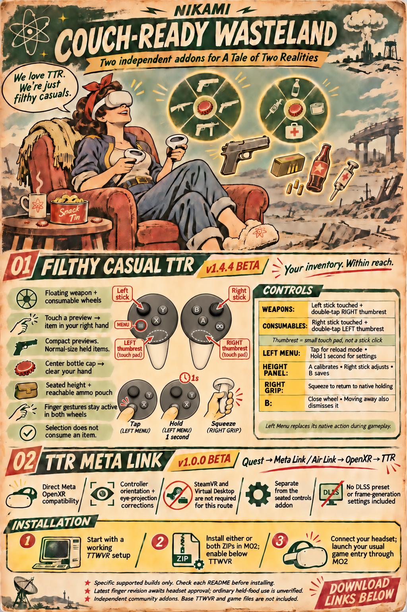

# TTR Meta Link

**Direct Meta Link / Air Link compatibility for A Tale of Two Realities.**

**v1.1.0-beta beta** · [Download the MO2 ZIP](https://github.com/nikamigaming-create/ttr-meta-link/releases/tag/v1.1.0-beta)
· [Filthy Casual TTR companion addon](https://github.com/nikamigaming-create/filthy-casual-ttr)

Quest → Meta Link / Air Link → Meta OpenXR → TTWVR.
SteamVR and Virtual Desktop are not required for this route. Steam itself is
still required for a Steam copy of Fallout: New Vegas.

This small xNVSE plugin fixes three compatibility issues observed with one
specific TTWVR / Meta runtime combination:

- A guarded 32-bit Meta IPC stack-cleanup correction for session creation.
- An OpenXR version request correction for controller orientation.
- Preserving Meta's reported eye FOV throughout rendering and submission,
  correcting the observed stereo spacing and fisheye-like head movement.

It selects Meta's 32-bit runtime for this game process only. No system-wide
OpenXR registry setting or installed game/Meta DLL is changed. A nonempty
explicit XR_RUNTIME_JSON selecting another runtime makes this helper skip.

## Install with MO2

1. Have a working, legally installed Fallout: New Vegas + TTW + TTWVR setup,
   including the base mod's xNVSE dependencies, and installed Meta Quest Link.
2. Check the exact supported hashes below. Close the game.
3. Install **TTR-Meta-Link-1.1.0-beta.zip** using MO2's archive installer. Enable it
   below TTWVR in the left pane. Keep only one copy of LocalMetaLink.dll enabled.
4. Connect the Quest through Link or Air Link and enter Link in the headset.
5. Launch your usual TTWVR game entry through MO2, not the stock game launcher.

The ZIP contains NVSE/Plugins/LocalMetaLink.dll and LocalMetaLink.ini. Enabled=1
is packaged by default. The seated-controls addon is optional and separate.
If updating from the earlier **TTWVR - Local Graphics** local mod, its embedded
LocalMetaLink.dll is the same plugin: do not enable duplicate copies. Keep any
personal graphics preset separately if desired.

## Exact supported versions

Tested on Quest 3, Meta OpenXR runtime Oculus 1.208.0. Runtime name alone is
insufficient: the file hashes below are the compatibility checks.

| File | SHA-256 |
| --- | --- |
| TTWVR.dll | `E428C4BD1209D58D21F75108808C86049E26C76E58A164AD864A61B99696BDAB` |
| RuntimeIPCServiceClient_32.dll | `D072611E9BA99EFC51FA5C9AAD9EECB6E1BA9FDDA8069EC96142241F75A57531` |

Only the standard Meta installation manifest is accepted in this release:
`C:\Program Files\Oculus\Support\oculus-runtime\oculus_openxr_32.json`.
The IPC DLL is expected in that same directory. Nonstandard Meta installation
paths are not supported by this version. Unknown hashes/instructions are refused;
do not remove the guards to force compatibility after an update.

The helper requests OpenXR 1.1.59 from the verified Meta runtime. All original
mod integration offsets and instruction guards are in src/ttwvr_meta_adapter.hpp.
The IPC guard and correction are in src/LocalMetaLink.cpp.

## What this does not change

No DLSS, anti-aliasing, render-resolution or frame-generation preset is included.
No guaranteed frame-rate improvement is claimed. Native eye-replay/graphics
options remain those of your existing TTWVR setup. It does not add hand gestures,
selectors, reload controls or save handling. No game or Meta binaries are bundled.

Earlier TTR builds received physical headset confirmation of controller orientation
and stereo fusion. This TTR 1.1 port has passed mapped-image API/FOV/scope/shadow
guard checks, but has not received a new physical Meta Link headset acceptance run. This is a compatibility beta,
not a replacement for TTWVR or a general-purpose OpenXR translation layer.

## Troubleshooting and removal

Check LocalMetaLink.log beside the plugin (MO2 may redirect it to Overwrite).
REFUSED means an exact compatibility or path guard failed. SKIPPED indicates
an explicit different runtime was selected. Connect Link before launching.
Remove stale simulator/SteamVR XR_RUNTIME_JSON overrides for the Meta route.
Close the game and untick this mod, or set Enabled=0, to disable the helper.

If a Steam game launches only from an automation tool, but not Explorer/MO2,
exit Steam and reopen it normally from the Start menu or Explorer. In our test,
the tool-started Steam registration was invisible to ordinary desktop games.
This is separate from VR or this plugin. Do not run a second game instance.

## Build

Install Visual Studio C++ Build Tools and a Windows SDK, then run build.cmd.
The build targets x86, matching FalloutNV.exe. package.ps1 creates the MO2 ZIP
and a file-hash manifest. The source and license are public; private diagnostics,
personal settings, dependency binaries and game assets are excluded.

Independent Nikami community addon for KUPOkinz's A Tale of Two Realities.
Not affiliated with or endorsed by Meta, Bethesda, or the base mod's author.
Original addon code: MIT; see LICENSE. External dependencies remain separately
licensed and must be obtained through their own distribution channels.

## Illustrated overview

The artwork is illustrative. It is not a gameplay screenshot.

## TTR 1.1 update

The scope-surface guard preserves the native shared colour surface around scope
rendering. `ScopeSurfaceGuard=1` enables it. `NativeShadows=0` leaves the optional
actor-shadow settings override off; this is not new environmental shadow rendering.
No personal DLSS, AA, resolution, textures or Link presets are distributed.
